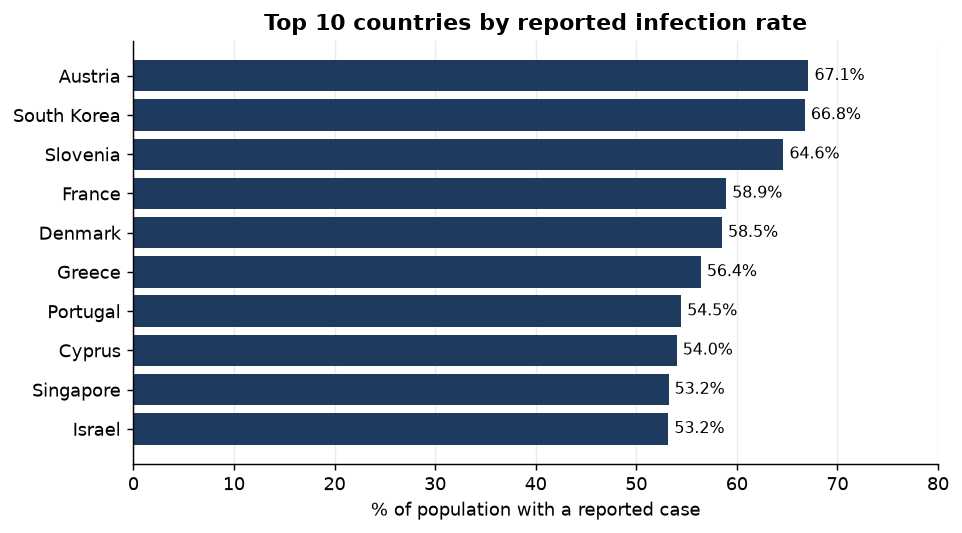
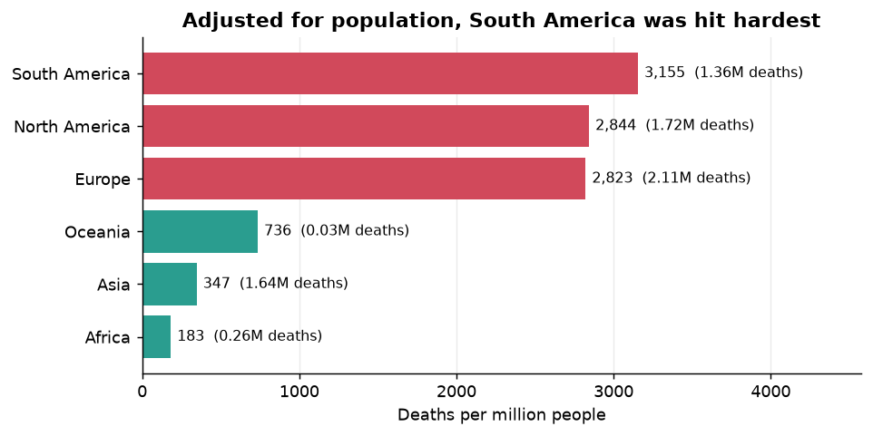
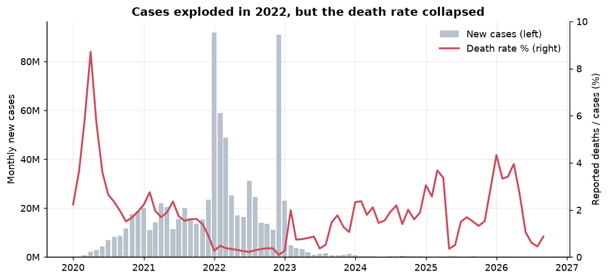
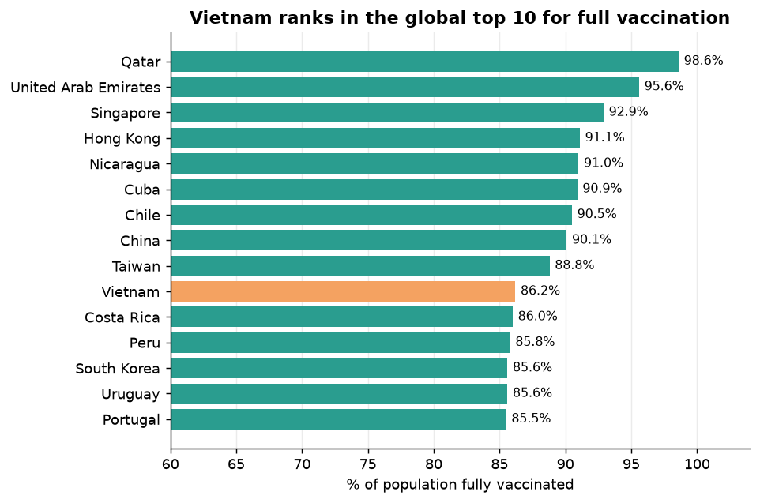
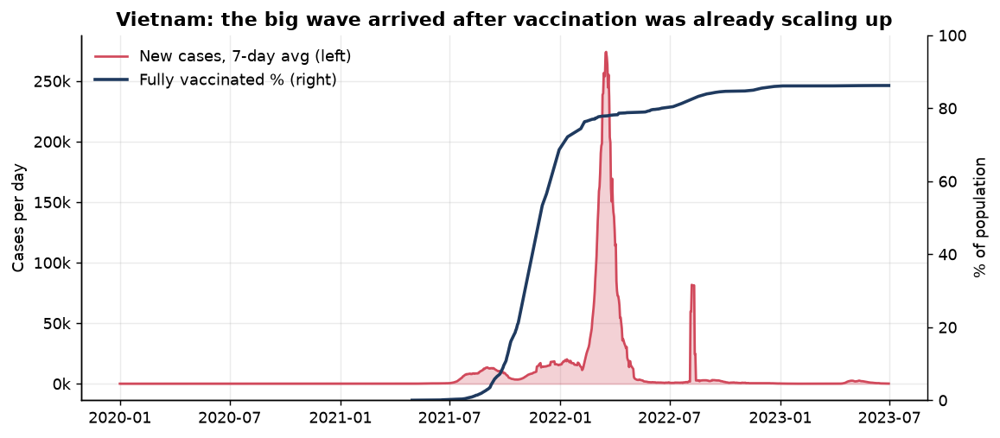

# COVID-19 Global Data Exploration with SQL

> Tiếng Việt: Dự án dùng SQL (CTE, Window Functions, Views) để phân tích 6+ năm dữ liệu COVID-19 của 237 quốc gia từ Our World in Data, trả lời 6 câu hỏi nghiệp vụ và xuất sẵn các View cho Tableau / Power BI.

## 1. Project Overview

As a data analyst supporting a public-health policy team, I was asked to answer: **where did COVID-19 hit hardest, how deadly was it over time, and how fast did countries vaccinate?** Everything is done in SQL on a ~580k-row country-by-day time series, then packaged as BI-ready views.

Business questions answered:

| # | Question | Techniques |
|---|----------|-----------|
| 1 | Case fatality rate per country (with a Vietnam spotlight) | `ROW_NUMBER`, `NULLIF` |
| 2 | Which countries had the highest share of population infected? | aggregates, `CASE WHEN`, `ROW_NUMBER` per continent |
| 3 | Deaths by continent | CTE (MAX per country, then SUM) |
| 4 | Global cases/deaths over time | `DATE_TRUNC`, `LAG` |
| 5 | Rolling vaccination progress | CTE + `SUM() OVER (PARTITION BY ... ORDER BY ...)`, `JOIN` |
| 6 | BI-ready views | `CREATE VIEW` (5 views) |

## 2. Dataset & Tools Used

- **Source:** [Our World in Data COVID-19 dataset](https://catalog.ourworldindata.org/garden/covid/latest/compact/compact.csv) · [codebook](https://docs.owid.io/projects/etl/api/covid/)
- **Size:** 629,868 rows x 61 columns, 2020-01-01 to 2026-10-18, 262 entities (237 real countries after cleaning, 581,316 rows)
- **Tools:** DuckDB (SQL engine, runs the raw CSV directly), Python 3 (runner script only). SQL is standard and ports to PostgreSQL / SQL Server with small tweaks (`read_csv_auto` -> `COPY`, `DATE_DIFF` -> `DATEDIFF`).

```text
sql/01_data_cleaning.sql   load raw CSV, profile quality, build covid_clean
sql/02_eda_queries.sql     the analysis (Q1-Q5)
sql/03_tableau_views.sql   5 views for Tableau / Power BI
scripts/run_all.py         runs the three files in order
scripts/make_charts.py     draws the README charts from the views (assets/*.png)
results.txt                captured output of the last run
```

**Reproduce**

```bash
pip install duckdb matplotlib
curl -L -o data/compact.csv https://catalog.ourworldindata.org/garden/covid/latest/compact/compact.csv
python scripts/run_all.py --out results.txt
python scripts/make_charts.py
```

## 3. Data Cleaning & Preparation

- **Removed 23 aggregate entities** (World, Asia, High-income countries, England, Olympics, ...) that have `continent IS NULL`. Keeping them would double count every metric.
- **Dropped rows without population** (2,528 rows, 2 entities), because per-capita metrics need it. 237 countries remain.
- **`COALESCE` daily flow columns** (`new_cases`, `new_deaths`, `new_vaccinations`) to 0. Cumulative columns stay `NULL` when never reported.
- **Count columns cast to BIGINT** so ratios and `ROUND` behave the same on PostgreSQL.
- **Last month excluded** from the monthly series because it is incomplete.
- **Safe division everywhere** with `NULLIF(denominator, 0)`.
- **Checks passed:** no duplicate country-day keys, no negative daily values.
- **Cumulative columns are handled with `MAX` per country *before* any `SUM`**, to avoid adding the same running total repeatedly.

## 4. Key Insights & Findings

**Case fatality rate (Q1)**
- Highest CFR among countries with 100k+ cases: **Peru 4.88%**, Egypt 4.81%, Mexico 4.39%, Bosnia and Herzegovina 4.06%.
- **Vietnam: 11.62M cases, 43,206 deaths, CFR 0.37%**, and 11.66% of the population reported infected. This is far below the countries above.

**Infection rate (Q2)**
- Highest share of population infected: **Austria 67.1%, South Korea 66.8%, Slovenia 64.6%, France 58.9%**.
- Among the 158 countries with 1M+ people, 23 reported infecting 40% or more of their population, while 68 stayed under 5%. Very low reported rates are likely affected by limited testing, so treat them as lower bounds.
- Leaders by continent: Mauritius (Africa), Austria (Europe), Puerto Rico (N. America), New Zealand (Oceania), Uruguay (S. America).



**Continents (Q3)**
- Deaths: Europe 2.11M, N. America 1.72M, Asia 1.64M, S. America 1.36M, Africa 0.26M, Oceania 33k.
- Adjusted for population, **South America is the worst (3,155 deaths per million)**, followed by N. America (2,844) and Europe (2,823). Asia has the third-highest total but only 347 per million.



**Global timeline (Q4)**
- Worldwide: **779.5M reported cases, 7.12M deaths** (reported death rate 0.91%).
- The monthly death rate fell from **8.7% (Apr 2020) to 0.27% (Jan 2022)**, even while cases hit their peak of **91.8M in January 2022** (Omicron). Vaccination and milder variants broke the link between cases and deaths.
- Deaths peaked earlier, in **January 2021 (444,768 in one month)**.
- Data caveat: Dec 2022 shows 91M cases (+710% MoM) and Feb 2023 a 2% death rate. Both look like reporting artifacts (likely bulk or backlog reporting) rather than real epidemic swings. I did not trace the source country, so treat this as a hypothesis.



**Vaccination (Q5)**
- **Vietnam: 90.8% got at least one dose and 86.2% fully vaccinated**, ranking in the global top 10 (Qatar 98.6%, UAE 95.6%, Singapore 92.9%).
- Fastest to 50% with at least one dose (population over 1M): Ireland 35 days, Israel 67, Mongolia 76, Uruguay 88.
- **Data-quality finding:** summing the daily `new_vaccinations` recovers only **52.6% of Vietnam's reported total doses** (US: 100%, Germany: 99.5%) because many days are missing. Rolling counts from daily data therefore understate Vietnam's progress (140.7 vs 267.4 doses per 100 people by mid-2023), so I show both series side by side, use `people_vaccinated` / `people_fully_vaccinated` for coverage and flag the rolling count as a lower bound (queries Q5 and Q5d).





## 5. Recommendations

1. **Early-warning KPIs should track deaths per case, not cases alone.** Case counts exploded in 2022 while mortality stayed low. Hospital capacity planning should key on deaths and admissions.
2. **Benchmark against peers by deaths per million**, not raw totals. Raw totals mislead (Asia's total looks large because of population).
3. **Treat low-testing countries' infection rates as lower bounds.** Resource allocation based on reported cases would under-serve them.
4. **Invest in reporting continuity.** Gaps in daily vaccination data (as in Vietnam's series) make real-time monitoring unreliable. Cumulative totals should be the system of record, with daily deltas derived from them.

## 6. Visual Preview

The charts above are generated from the SQL views by `scripts/make_charts.py`. BI views are ready in `sql/03_tableau_views.sql` (`v_country_summary`, `v_continent_deaths`, `v_global_monthly`, `v_vaccination_progress`, `v_vietnam_timeline`). Sample output (Q3):

| continent | total_deaths | deaths_per_million |
|-----------|-------------:|-------------------:|
| Europe | 2,112,331 | 2,823 |
| North America | 1,718,967 | 2,844 |
| Asia | 1,637,931 | 347 |
| South America | 1,358,389 | 3,155 |
| Africa | 258,290 | 183 |
| Oceania | 33,173 | 736 |

> To add a dashboard screenshot: connect Tableau Public to `data/export_*.csv` (export commands are at the bottom of `03_tableau_views.sql`) and save the image to `assets/dashboard_preview.png`.

## Limitations

Reported counts depend on each country's testing and reporting policy and are not comparable one-to-one. The dataset is a live snapshot, so numbers will shift slightly when re-downloaded.
