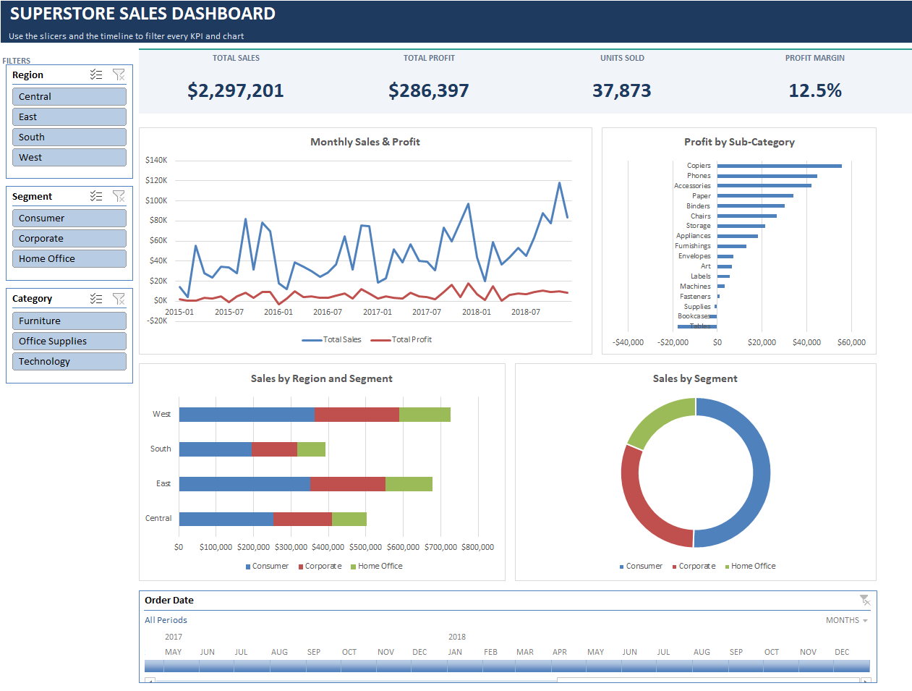

# Superstore Sales Analysis: Excel PivotTables & Interactive Dashboard



## 1. Project Overview

**Business problem.** A US retailer sold $2.3M of goods over 2015-2018 but earns only a 12.5% profit margin. As the data analyst, I had to answer: *which products, regions and segments drive profit, and where is money being lost?* The deliverable is a self-service Excel dashboard that a sales manager can filter without writing a formula.

## 2. Dataset & Tools Used

- **Data:** Sample Superstore sales (CSV mirror of the classic Kaggle dataset, [source](https://github.com/leonism/sample-superstore)). 10,800 raw rows x 21 columns, 9,994 order lines after cleaning, 5,009 orders, 793 customers, Jan 2015 to Dec 2018.
- **Tools:** Microsoft Excel (Tables, PivotTables, Pivot Charts, Slicers, Timeline, `GETPIVOTDATA`, calculated field), Python (`pandas`, `xlsxwriter`, `pywin32`) to build the workbook reproducibly.

```text
data/SampleSuperstore.csv            raw data
scripts/build_excel_report.py        cleans data and builds the workbook (see "Rebuild")
output/Superstore_Dashboard.xlsx     final workbook: Raw_Data | Pivot_Analysis | Dashboard
assets/dashboard_preview.png         screenshot used above
```

**Workbook structure**

| Sheet | Content |
|-------|---------|
| `Raw_Data` | Cleaned data as an Excel Table (`tblSales`) with formatted dates, currency and %, plus helper columns: `Order Year`, `Order Month`, `Order YearMonth`, `Profit Margin`, `Delivery Days` (all formulas) |
| `Pivot_Analysis` | 6 PivotTables: KPIs, monthly trend, category/sub-category, region x segment, segment split, profit by sub-category |
| `Dashboard` | KPI cards (`GETPIVOTDATA`), 4 Pivot Charts, Region / Segment / Category slicers and an Order Date timeline, all connected to every PivotTable |

## 3. Data Cleaning & Preparation

- **Removed 806 blank records**: rows that kept an Order ID but had every other field empty. This left exactly 9,994 rows with unique Row IDs.
- **Fixed 11 missing postal codes** (all Burlington, Vermont) with the correct ZIP `05401`.
- **Converted text dates** (`m/d/yyyy`) to real dates, quantities to integers, and kept postal codes as text so leading zeros survive.
- **Added helper columns** for year, month, margin and delivery time so pivots stay simple.
- **Margin KPI is a calculated field** (`Profit / Sales` on the totals) instead of an average of row margins, which would be wrong.

## 4. Key Insights & Findings

**Overall:** $2,297,201 sales, $286,397 profit, 37,873 units, **12.5% margin**.

- **Growth is real:** sales grew from $484K (2015) to $733K (2018), +51%, and profit from $49.5K to $93.4K (+89%). Margin stayed in the 10-13% range.
- **Furniture earns almost nothing:** it brings in $742K (32% of sales) but only $18K profit, a **2.5% margin**, against 17.0% for Office Supplies and 17.4% for Technology.
- **Tables are the biggest leak:** $207K sales but **-$17.7K profit (-8.6% margin)**, with an average discount of **26%**. Bookcases (-$3.5K) and Supplies (-$1.2K) also lose money.
- **Deep discounts destroy profit:** the 1,393 order lines discounted 30% or more generated $363K of sales but **-$135K of profit**, while the other 8,601 lines made **+$422K**. Lines discounted under 30% are solidly profitable.
- **Best sub-categories:** Copiers ($55.6K, 37% margin), Phones ($44.5K), Accessories ($41.9K, 25%), Paper ($34.1K, 43%).
- **Regions:** West leads (14.9% margin, $108K profit) and East follows (13.5%). **Central is the weak spot**: $501K sales but only a 7.9% margin.
- **Segments:** Consumer is 51% of sales ($1.16M), but Home Office has the highest margin (14.0% vs 11.5%).
- **Weakest states by profit:** Texas (-$25.7K), Ohio (-$17.0K), Pennsylvania (-$15.6K), Illinois (-$12.6K).

## 5. Recommendations

1. **Cap discounts at 20%** (require manager approval above it). On this data, discounts of 30%+ turned $363K of sales into a $135K loss.
2. **Reprice or drop Tables and Bookcases.** Cut Tables' 26% average discount or renegotiate supplier cost. Reallocate floor space to Copiers, Phones and Accessories.
3. **Fix the Central region** (7.9% margin, with Texas and Illinois among the biggest loss-makers): review local discount rules and shipping cost.
4. **Grow Home Office and Corporate** with bundles of high-margin Technology and Paper products. They convert sales to profit better than Consumer.

## 6. How to Use the Dashboard

Open `output/Superstore_Dashboard.xlsx` in desktop Excel (2013 or later; I did not test Excel Online or Excel for Mac). Click a Region / Segment / Category button (Ctrl-click for several) or drag the Order Date timeline: the KPI cards, all charts and all PivotTables update together. Use the funnel icon to clear a filter.

## Rebuild

```bash
pip install pandas xlsxwriter pywin32
python scripts/build_excel_report.py            # needs Windows + desktop Excel (adds pivots, slicers)
python scripts/build_excel_report.py --stage1   # skeleton only: Raw_Data, layout, KPI formulas
```

Verification: filtering Region = West in the dashboard returns $725,458 sales, $108,418 profit, 12,266 units and a 14.9% margin, identical to the same figures computed independently in pandas.
