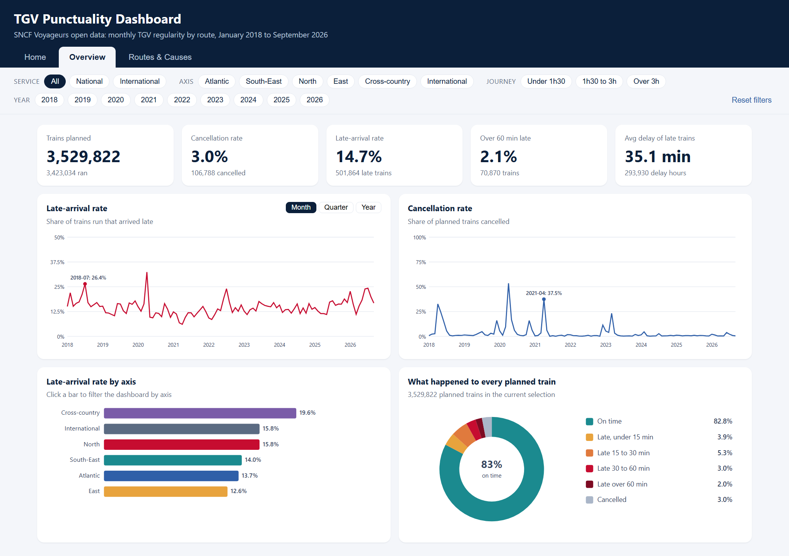
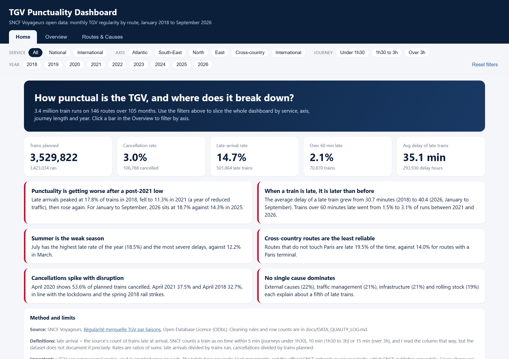
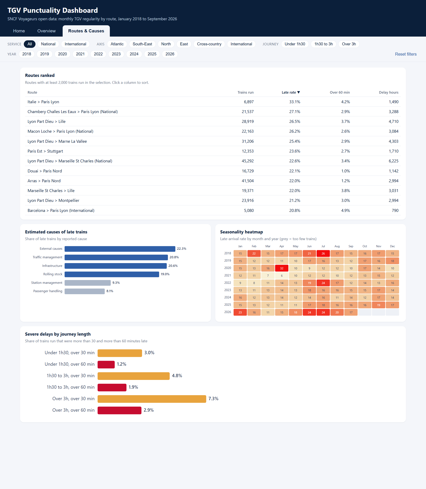

# TGV Punctuality Analysis: Power BI Dashboard on SNCF Open Data



**Live interactive dashboard:** [open it in your browser](https://corgi-coder99.github.io/data-analyst-portfolio/03-sncf-punctuality-powerbi/dashboard/index.html). It is one HTML file (also in [`dashboard/index.html`](./dashboard/index.html)) and works offline. Three pages (Home, Overview, Routes & Causes), cross-filtering by service, axis, journey length and year.

## 1. Project overview

How punctual is the TGV, and where does it break down? As an analyst for a rail operator's performance team, I wanted to answer five questions from eight years of official data:

1. Is punctuality improving or getting worse?
2. When trains are late, how late?
3. Which routes, axes and seasons are the weak points?
4. How do cancellations behave during disruptions?
5. What causes the delays?

Deliverables: a cleaned star-schema dataset ready for Power BI, DAX measures, a step-by-step Power BI build guide, an interactive HTML dashboard with the same three pages, and a LinkedIn post draft.

## 2. Dataset and tools

- **Source:** SNCF Voyageurs, [Régularité mensuelle TGV par liaisons](https://ressources.data.sncf.com/explore/dataset/regularite-mensuelle-tgv-aqst/), Open Database Licence (ODbL). Please keep the attribution if you reuse the derived tables.
- **Size:** 12,907 rows (one per route per month), 105 months (2018-01 to 2026-09), 146 routes, 59 stations, 26 columns.
- **Tools:** Power BI + DAX (model and measures provided), Python (pandas) for cleaning, plain HTML/JavaScript/SVG for the interactive dashboard.

```text
data/processed/    star schema CSVs: fact_route_month, fact_delay_cause, dim_route, dim_date
scripts/           download_data.py, clean_and_model.py, build_dashboard.py, make_pbip.py
powerbi/           TGV_Punctuality.pbip (prebuilt model), measures.dax, sncf_theme.json
docs/              POWERBI_BUILD_GUIDE.md, DATA_QUALITY_LOG.md, LINKEDIN_POST.md
dashboard/         index.html (generated), template.html
assets/            dashboard screenshots
```

**Rebuild**

```bash
pip install pandas
python scripts/download_data.py
python scripts/clean_and_model.py
python scripts/build_dashboard.py
```

## 3. Data cleaning

Full log with row counts: [`docs/DATA_QUALITY_LOG.md`](./docs/DATA_QUALITY_LOG.md). Highlights:

- **Cancellations above planned trains (63 rows, mostly April 2020):** planned trains raised to the number cancelled, so rates never exceed 100%.
- **Negative counts (43 rows):** impossible values for trains more than 30 minutes late, set to 0.
- **Thresholds that contradict each other (388 rows):** for example more trains over 60 minutes late than over 30. The counts are raised to the more severe bucket so the chain "late >= over 15 >= over 30 >= over 60" always holds.
- **Implausible average delays:** a column with values down to -472 minutes is not used. Delay is rebuilt as average delay of late trains times number of late trains.
- **Journey time of 0 (73 rows):** set to missing.
- **Derived fields:** station names cleaned, route label, an axis (South-East, Atlantic, North, East, Cross-country, International) derived from each route's Paris terminal, journey-length band.
- **Delay causes** reshaped from six percentage columns into a long table (estimated late trains per cause).

## 4. Key findings



- **Scale:** 3.53M planned train runs, 3.0% cancelled, **14.7% arrived late**, 2.1% more than an hour late. Average delay of a late train: 35.1 minutes.
- **Punctuality is getting worse after a post-2021 low.** Late arrivals fell from 17.8% (2018) to 11.3% (2021, a year of reduced traffic), then rose: 14.3% (2022), 15.1% (2025). For January to September, **2026 is at 18.7% against 14.3% in 2025**.
- **Late trains are later.** The average delay of a late train grew from 30.7 minutes (2018) to 40.4 (2026, January to September). Trains more than 60 minutes late went from **1.5% (2021) to 3.1% (2026)**.
- **Summer is the weak season.** July has the highest late rate (18.5%) and the most severe delays, against 12.2% in March.
- **Cross-country routes are the least reliable.** Routes without a Paris terminal are late 19.5% of the time, against 14.0% for Paris routes.
- **Cancellations spike with disruption:** 53.6% of planned trains in April 2020, 37.5% in April 2021 and 32.7% in April 2018, in line with the lockdowns and the spring 2018 rail strikes (the strike link comes from public context, not from the dataset).
- **No single cause dominates:** external causes (22%), traffic management (21%), infrastructure (21%) and rolling stock (19%).
- **Severe delays grow with distance.** Trains on journeys over 3 hours are more than 30 minutes late 7.3% of the time, against 3.0% for journeys under 1h30.



## 5. Recommendations

1. **Treat 2026 as an alert.** The 4.4-point jump in late arrivals against the same months of 2025 is across every axis (for example North 14.7% to 21.4%, International 17.1% to 23.5%), which suggests a network-wide factor rather than one corridor (the data cannot say which). A root-cause review of 2026 is the first priority.
2. **Add a severity KPI next to punctuality.** Late rate alone hides that delays are getting longer. Track the share over 30 and over 60 minutes.
3. **Focus resilience work on cross-country and summer.** They combine the highest late rates with the most severe delays: a summer-specific plan (maintenance windows, buffers) for the routes that avoid Paris.
4. **Build disruption playbooks for cancellations.** The spikes are rare but extreme, so the cost sits in a handful of months.

## 6. Limits

- A TGV serving several routes is counted on each of them. **These are route-level movements, not SNCF's official global or per-axis regularity**, which SNCF publishes separately and warns cannot be rebuilt from this dataset.
- "Late arrival" is the dataset's own count of trains late at arrival. SNCF's tolerance is 5, 10 or 15 minutes depending on journey length, and I read the column that way, but the dataset does not document it precisely.
- Cause shares are an estimate: each route-month's published percentages applied to its late trains.
- The axis is derived from the Paris terminal, not a field in the source.
- 2026 covers only January to September, so year comparisons use the same months.

## 7. Build the Power BI report

Open [`powerbi/TGV_Punctuality.pbip`](./powerbi/TGV_Punctuality.pbip), a Power BI Project with the data, model, relationships and all 24 DAX measures already in place (click Home > Refresh once after opening), then build the three pages with [`docs/POWERBI_BUILD_GUIDE.md`](./docs/POWERBI_BUILD_GUIDE.md). Or build everything from scratch: load the four CSVs, create the four relationships, paste [`powerbi/measures.dax`](./powerbi/measures.dax) and import the theme. Reference values at the end of the guide let you check your report.
